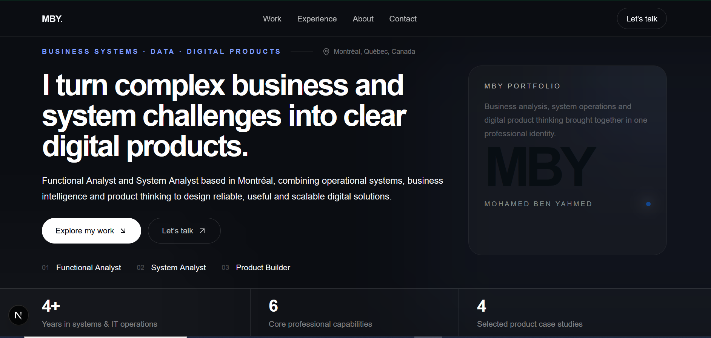

# MBY STUDIO PORTFOLIO

> **Functional Analyst • System Analyst • Product Builder**  
> Turning complex business and system challenges into clear digital products.

<p align="center">
  
</p>

## Overview

MBY Studio Portfolio is the central hub of my professional work and selected case studies.

The portfolio is designed to show how I approach business and system challenges through functional analysis, process mapping, systems thinking, business intelligence, structured documentation and digital product development.

Rather than acting as a traditional online résumé, the site focuses on **how problems are analyzed, structured and translated into practical deliverables**.

## Professional Positioning

My work sits at the intersection of:

- Business & Functional Analysis
- Systems Analysis
- Business Process Mapping
- Requirements & Business Rules Documentation
- ERP / Application Support Analysis
- Data & Business Intelligence
- Process Improvement
- Digital Product Thinking

The portfolio is progressively evolving toward a consulting-oriented experience designed to demonstrate not only what I know, but also **what I can take ownership of and deliver**.

## How I Work

My approach follows a structured delivery mindset:

**Understand → Map → Analyze → Recommend → Validate → Deliver**

This approach is reflected throughout the case studies and project documentation presented in the portfolio.

## What This Portfolio Demonstrates

| Domain | Capabilities |
|---|---|
| Functional Analysis | Requirements, business rules, fit/gap, acceptance criteria |
| Systems Analysis | Application landscapes, system interactions, functional flows |
| Process Mapping | End-to-end processes, swimlanes, operational workflows |
| Business Intelligence | Power BI, KPIs, reporting and data interpretation |
| ERP / Application Analysis | Functional support, process analysis, incident investigation |
| Product Thinking | Discovery, validation, roadmap and solution framing |
| Documentation | Structured functional and business documentation |
| Front-End Delivery | Next.js, TypeScript, Tailwind CSS |

## Selected Work

| Project | Description | Primary Focus | Status |
|---|---|---|:---:|
| 🟦 **BlueKioskTech** | Digital product and validation platform supporting technology concepts and product initiatives. | Product Strategy · Functional Analysis · Digital Delivery | ✅ Active |
| 🏭 **Manufacturing Business Systems Mapping** | Conceptual case study mapping a manufacturing operating model across CRM, project execution, ERP/P2P, data and governance. | Business Systems Analysis · Process Mapping · Functional Architecture | ✅ Published |
| 📊 **BIXI Operations Dashboard** | Operational analytics case study built around Power BI and KPI-driven decision support. | Business Intelligence · Data Analysis | 🚧 In Progress |
| 🤖 **Executive AI English Coach** | AI-assisted learning product concept focused on structured professional English development. | Product Design · AI-Assisted Experience | 🚧 In Progress |
| ✈️ **TripScore AI** | Travel planning product concept focused on structured discovery and decision support. | Product Discovery · Product Thinking | 🚧 In Design |

## Manufacturing Business Systems Mapping

The **Manufacturing Business Systems Mapping** case study demonstrates a structured approach to analyzing a multi-system operating environment.

It covers:

- Business challenge framing
- Analysis methodology
- End-to-end process architecture
- Systems and data architecture
- Process inventory
- CRM deep dive
- Procurement / P2P deep dive
- Data governance and controls
- Process improvement framework
- Delivery-oriented conclusions

The case study is intentionally presented as a **conceptual professional case study** and does not represent a client implementation.

## Technology Stack

| Layer | Technology | Purpose |
|---|---|---|
| 🚀 Framework | Next.js 16 | App Router, performance and scalable application structure |
| 💻 Language | TypeScript | Type safety and maintainability |
| 🎨 Styling | Tailwind CSS | Responsive design system and rapid UI development |
| ✨ Motion | Framer Motion | Interface transitions and interactive visual storytelling |
| 🧩 UI Architecture | React Components | Modular and reusable components |
| 📂 Content Architecture | TypeScript Content Modules | Separation between content and presentation |
| ☁️ Deployment | Vercel | Continuous deployment from GitHub |
| 🔄 Version Control | Git & GitHub | Source control and release workflow |

## Architecture

```text
app/
components/
content/
public/
styles/
lib/
```

## Core Principles

- Business-first thinking
- Clear functional reasoning
- Structured documentation
- User-centered design
- Modular architecture
- Reusable components
- Responsive delivery
- Continuous improvement
- Scalability by design

## Design Decisions

- Case-study-driven content
- Laptop-first responsive design with dedicated tablet, mobile and large-screen behavior
- Modular project-specific sections
- Motion used to explain systems and relationships, not only for decoration
- Clear separation between portfolio content and presentation logic
- Progressive evolution toward a bilingual FR/EN experience

## Key Features

- Professional homepage
- Dynamic project pages
- Detailed case studies
- Responsive layout across desktop, laptop, tablet and smartphone
- Interactive motion system
- Project-specific visual storytelling
- Vercel production deployment
- FR/EN language switch planned

## Local Development

```bash
npm install
npm run dev
```

Production build:

```bash
npm run build
```

## Deployment

```text
GitHub (main)
      ↓
    Vercel
      ↓
 Production
```

Production portfolio:

**https://mby-studio-portfolio.vercel.app**

## Roadmap

- [x] Portfolio foundation
- [x] Responsive homepage
- [x] Dynamic project pages
- [x] Manufacturing Business Systems Mapping case study
- [x] GitHub → Vercel production workflow
- [ ] FR/EN language switch
- [ ] Consulting / Services page
- [ ] Professional recommendations / LinkedIn proof
- [ ] Consulting-focused calls to action
- [ ] Custom domain
- [ ] Continued case-study expansion

## Next Evolution

The next phase of the portfolio will focus on evolving the site from a professional portfolio into a stronger **consulting and mandate acquisition platform**.

The objective is to help recruiters, IT managers and potential clients quickly understand:

- what types of mandates I can take on;
- how I approach business and systems analysis;
- what deliverables I can produce;
- how I structure and validate my work;
- what professional evidence supports my experience;
- how to contact me to discuss a mandate.

The public website will remain focused on services, delivery capability, case studies, quality and professional credibility.

## About

**Mohamed Ben Yahmed**

Functional Analyst • System Analyst • Product Builder

Montréal, Québec, Canada

## Connect

- 🌐 **Portfolio:** https://mby-studio-portfolio.vercel.app
- 💻 **GitHub:** https://github.com/BenYah10
- 💼 **LinkedIn:** Add your public LinkedIn profile URL here

## License

© Mohamed Ben Yahmed. All Rights Reserved.
